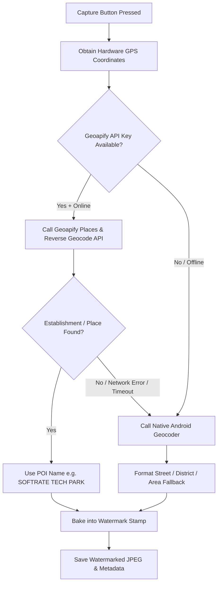

# Geoapify Geocoding & Places Integration Guide

## 1. Overview

**Free Geo Tagging** integrates **Geoapify** as its primary cloud reverse-geocoding and Points of Interest (POI) engine, backed by a seamless fallback to Android's native system Geocoder.

This integration solves the limitation of standard street geocoding by resolving exact **commercial establishments, company offices, tech parks, and landmark names** (e.g., `SOFTRATE TECH PARK`, `Poonamallee, India`) rather than just raw street door numbers.

---

## 2. Why Geoapify?

| Requirement | Google Places API | Geoapify (Selected) | Android Native Geocoder |
| :--- | :--- | :--- | :--- |
| **Credit Card Required?** | **Yes** (Strict Google Cloud requirement) | **No** (Email only) | No |
| **Free Tier Quota** | $200 credit (~5,000–20,000 req/mo) | **3,000 requests / day** (~90,000 req/mo) | Unlimited (on-device) |
| **Place Names (POI / Tech Parks)** | Yes | **Yes** (Places API + Categories) | Rare (Street/Door number only) |
| **Commercial Mobile App Allowed?** | Yes | **Yes** (Allowed on Free plan) | Yes |
| **Setup Time** | ~15–30 min (Billing setup) | **< 1 minute** | 0 min |

---

## 3. How to Obtain a Free Geoapify API Key

1. Go to [https://www.geoapify.com/](https://www.geoapify.com/) and click **Sign Up Free** (no credit card required).
2. Open the **Geoapify MyProjects Dashboard**.
3. Create a project named `Free Geo Tagging`.
4. Copy your generated **API Key** (a 32-character alphanumeric key).

---

## 4. Configuration

Open [`src/core/constants/appConstants.ts`](file:///c:/projects/Cam-Locator/src/core/constants/appConstants.ts) and paste your key:

```typescript
export const APP_CONSTANTS = {
  // ... other constants
  GEOAPIFY_API_KEY: 'YOUR_GEOAPIFY_API_KEY_HERE',
} as const;
```

> [!TIP]
> The app can also persist custom keys dynamically via `GeoapifyService.setApiKey('...')` without rebuilding the application bundle.

---

## 5. Architectural Pipeline & Fallback Strategy

The application enforces a **fail-safe, offline-first** cascade:



### Key Guarantees:
1. **Zero Blocker Timeout**: A strict 4.5-second timeout guard prevents cloud network lag from freezing camera responsiveness.
2. **Offline-First Resilience**: If the user is on airplane mode or in low-connectivity areas, the system automatically falls back to Android's local geocoder cache.
3. **Smart Place Extraction**: If Geoapify or the system returns a raw building digit (e.g. `"45"`), the parser automatically elevates the street or area name to keep the title clean.

---

## 6. API Endpoints Used

### A. Places API (`/v2/places`)
Searches Points of Interest within a 150-meter radius around the camera coordinates:
```http
GET https://api.geoapify.com/v2/places
  ?categories=commercial,office,education,entertainment,catering,building,production
  &filter=circle:{longitude},{latitude},150
  &bias=proximity:{longitude},{latitude}
  &limit=3
  &apiKey={API_KEY}
```
*Identifies: Tech parks, commercial offices, factories, colleges, and registered landmarks.*

### B. Reverse Geocoding API (`/v1/geocode/reverse`)
Resolves the administrative hierarchy for the subtitle (e.g. `Poonamallee, India`):
```http
GET https://api.geoapify.com/v1/geocode/reverse
  ?lat={latitude}
  &lon={longitude}
  &apiKey={API_KEY}
```

---

## 7. Limitations & Operational Constraints

### 1. Daily Quota Limit (Free Tier)
- **Quota**: **3,000 credits per day** (resets every 24 hours at 00:00 UTC).
- **Cost**: 1 credit per reverse geocoding call, 1 credit per places search call.
- **Exceeding Quota**: Geoapify responds with HTTP `429 Too Many Requests`. The app gracefully intercepts this and seamlessly defaults to Android's built-in Geocoder.

### 2. Rate Limit (Requests per Second)
- **Free Tier Limit**: **5 Requests Per Second (RPS)**.
- **Handling**: In standard camera operation, user photo captures take several seconds, making RPS limits virtually impossible to breach.

### 3. Network Dependency
- Geoapify requires active data (Wi-Fi or Cellular).
- Without internet, the app bypasses Geoapify and relies entirely on Android's native offline geocoding cache.

### 4. Data Attribution Requirements
- Geoapify is powered by OpenStreetMap and OpenAddresses data.
- In commercial distribution, open-source attribution is standard (already noted in project legal/license files).

---

## 8. Troubleshooting

| Symptom | Probable Cause | Resolution |
| :--- | :--- | :--- |
| Watermark displays road name instead of tech park | `GEOAPIFY_API_KEY` is empty | Add your API key in `src/core/constants/appConstants.ts`. |
| Watermark shows `GPS LOCATION` | Device is offline with no cached coordinates | Verify GPS fix has acquired (`ACC < 20m`) and device has network connectivity. |
| HTTP 401 Unauthorized | Invalid API key | Double check your 32-character key from Geoapify dashboard. |
| HTTP 429 Too Many Requests | 3,000 daily credit limit reached | Automatic fallback takes over; quota resets at 00:00 UTC. |
